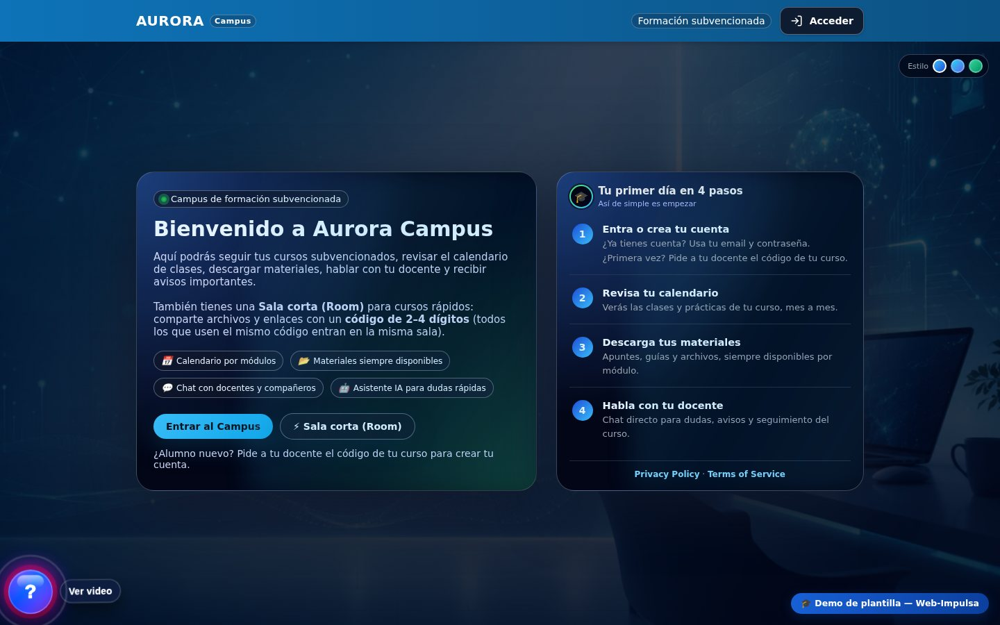
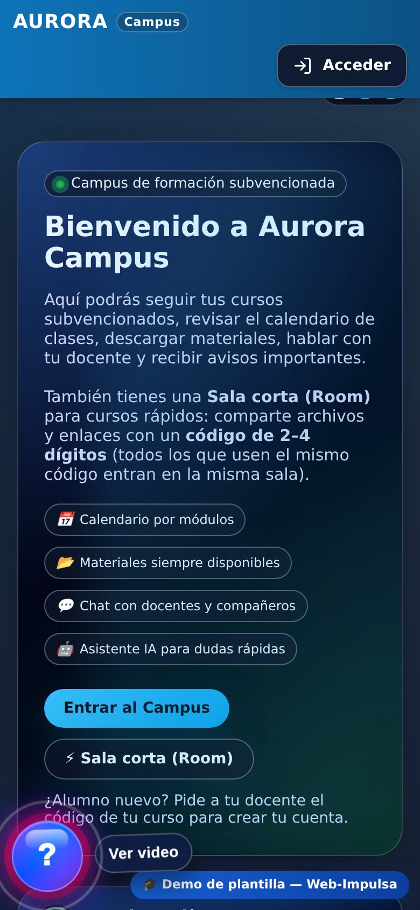
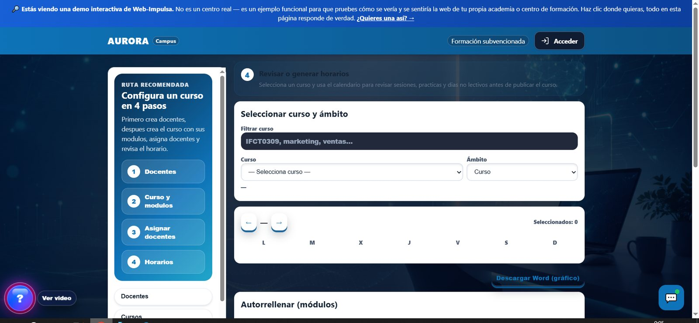

# MEATZE Campus 🎓

MEATZE Campus is a custom-built educational platform developed with **Django**.  
It provides separate panels for **students, teachers, and administrators**, integrates AI assistants, scheduling, and WhatsApp Cloud API notifications.

This repository contains the **backend source code** of the MEATZE Campus platform.

---

<!-- readme-screenshots -->
## Screenshots

<p align="center">
  
  
</p>
<p align="center"><em>Aurora Campus — public home · Mobile</em></p>

<p align="center">
  
</p>
<p align="center"><em>Course setup in 4 steps (demo) <sub>(AI-generated illustration)</sub></em></p>
<!-- readme-screenshots -->

## 🚀 Main Features

- Django 6.x backend
- Role-based access (Alumno / Docente / Admin)
- Custom admin panel (not Django Admin)
- REST API (Django Rest Framework)
- AI assistant integration (local LLM / Ollama-ready)
- WhatsApp Cloud API integration
- Course, calendar, and schedule management
- Secure authentication with PIN / password flows
- PostgreSQL database

---

## 🗂️ Project Structure

```
meatze/
├── ai/                 # AI assistant logic
├── api/                # REST API endpoints
├── core/               # Core app (auth, common logic)
├── panel/              # Panels (alumno, docente, admin)
├── meatze_site/        # Django project settings
├── templates/          # HTML templates
├── static/             # Static assets
├── utils/              # Utilities and helpers
├── manage.py
├── requirements.txt
└── .env.example
```

---

## 🔐 Environment Variables

Sensitive data is **not stored in the repository**.  
You must create a `.env` file based on `.env.example`.

Example:

```bash
cp .env.example .env
nano .env
```

Main variables used:

- `DJANGO_SECRET_KEY`
- `DJANGO_DEBUG`
- `DJANGO_ALLOWED_HOSTS`
- `DB_NAME`, `DB_USER`, `DB_PASSWORD`
- `EMAIL_HOST_USER`, `EMAIL_HOST_PASSWORD`
- `WA_TOKEN`, `WA_PHONE_ID`

⚠️ Never commit your real `.env` file.

---

## 🧰 Installation (Development)

### 1️⃣ Clone the repository

```bash
git clone git@github.com:SerkaFox/meatze-campus.git
cd meatze-campus
```

### 2️⃣ Create virtual environment

```bash
python3 -m venv venv
source venv/bin/activate
```

### 3️⃣ Install dependencies

```bash
pip install -r requirements.txt
```

### 4️⃣ Configure environment

```bash
cp .env.example .env
# edit .env with your values
```

### 5️⃣ Run migrations

```bash
python manage.py migrate
```

### 6️⃣ Start development server

```bash
python manage.py runserver
```

Server will be available at:
```
http://127.0.0.1:8000/
```

---

## 🐘 Database

- PostgreSQL (recommended)
- SQLite can be used only for local testing

Make sure PostgreSQL user and database exist before running migrations.

---

## 🧠 AI Assistant

The platform supports:
- Local LLMs (Ollama)
- Vector embeddings
- Custom knowledge base per project

AI index path:
```
docs/autogen_strict/assistant_index.json
```

---

## 📲 WhatsApp Cloud API

Used for:
- Notifications
- Admin alerts
- Automated assistant messages

Configured via environment variables.

---

## 🔒 Security Notes

- Secrets are loaded from `.env`
- `.gitignore` excludes sensitive folders
- Production requires `DEBUG=0`
- Use HTTPS + reverse proxy (Nginx)

---

## 🧑‍💻 Author

**SerkaFox**  
Full‑stack developer & system architect  

---

## 📄 License

Private project.  
All rights reserved.

